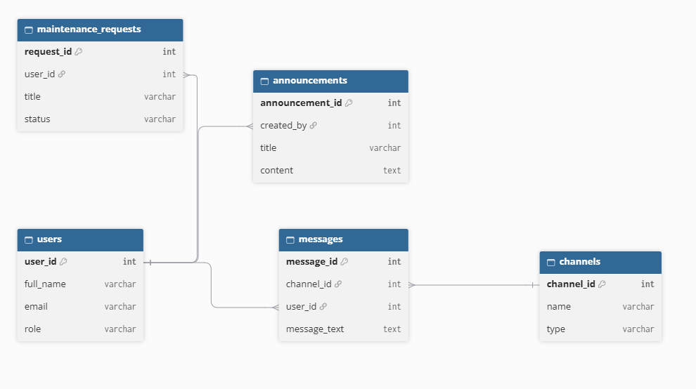

# Building Management System

A web application for residents and building managers to handle community chat rooms, maintenance requests and building announcements. Built for the IT 2001 Web Programming course.

> **Status: Milestone 1** – project structure, static single-page frontend and draft ERD. The backend, database and API are added in the next milestones.

## Entities and relationships



| Entity | Main fields | Relationships |
| --- | --- | --- |
| `users` | `user_id`, `full_name`, `email`, `role` | one user has many `maintenance_requests`, `announcements` (as `created_by`) and `messages` |
| `channels` | `channel_id`, `name`, `type` | one channel has many `messages` |
| `messages` | `message_id`, `channel_id`, `user_id`, `message_text` | belongs to one channel and one user |
| `maintenance_requests` | `request_id`, `user_id`, `title`, `status` | belongs to one user |
| `announcements` | `announcement_id`, `created_by`, `title`, `content` | belongs to one user (author) |

## Roles and test accounts

| Role | Purpose | Test account |
| --- | --- | --- |
| `admin` | Manages users, channels, announcements and maintenance requests | added with the sample data (Milestone 2) |
| `resident` | Chats, reads announcements, submits maintenance requests | added with the sample data (Milestone 2) |

## External API

Planned feature: a **weather card on the dashboard** (weather at the building's location), loaded through a backend endpoint, with a friendly message when the API is unavailable. The card is already placed in the static dashboard (`frontend/views/dashboard.html`). Implemented in Milestone 3.

## Project structure

```
frontend/   index.html, css/, js/ (app.js, router.js), views/ (one HTML file per view), static/
backend/    routes/, services/, dao/, middleware/, config/, logs/ (not committed)
docs/       ERD.png, AI_LOG.md
AGENTS.md   rules for AI assistants
```

Frontend views: login, register, dashboard, chat channels, announcements, maintenance, users, profile, 404. Navigation is hash-based (`#/dashboard`), so pages change without a reload.

## Running locally (Milestone 1)

1. Put the project folder in `htdocs` and start **Apache** in XAMPP.
2. Open `http://localhost/building-management-system/frontend/`.
3. Any email/password on the login page opens the dashboard (static preview, nothing is saved).

Later milestones add: importing the `.sql` file (Milestone 2) and creating `backend/config/config.php` from `backend/config/config.example.php`.

## Links

- Swagger documentation: _added in Milestone 3_
- Deployed application: _added in Milestone 5_
